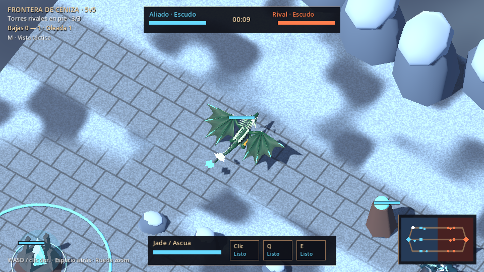
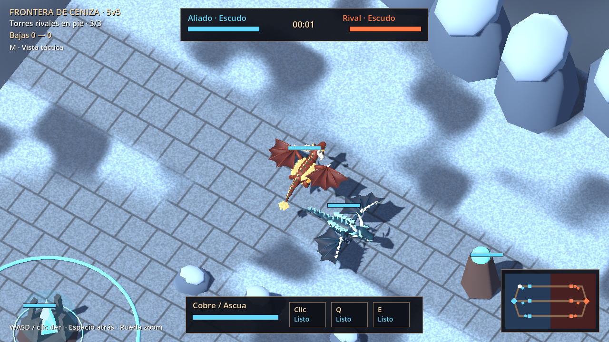
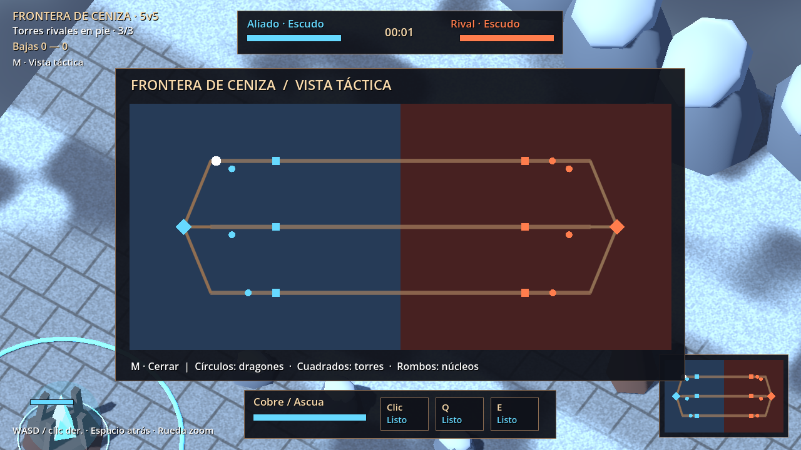
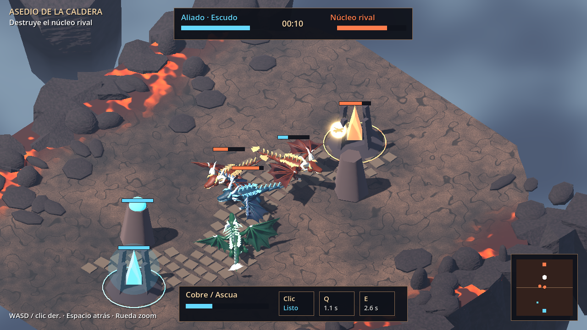
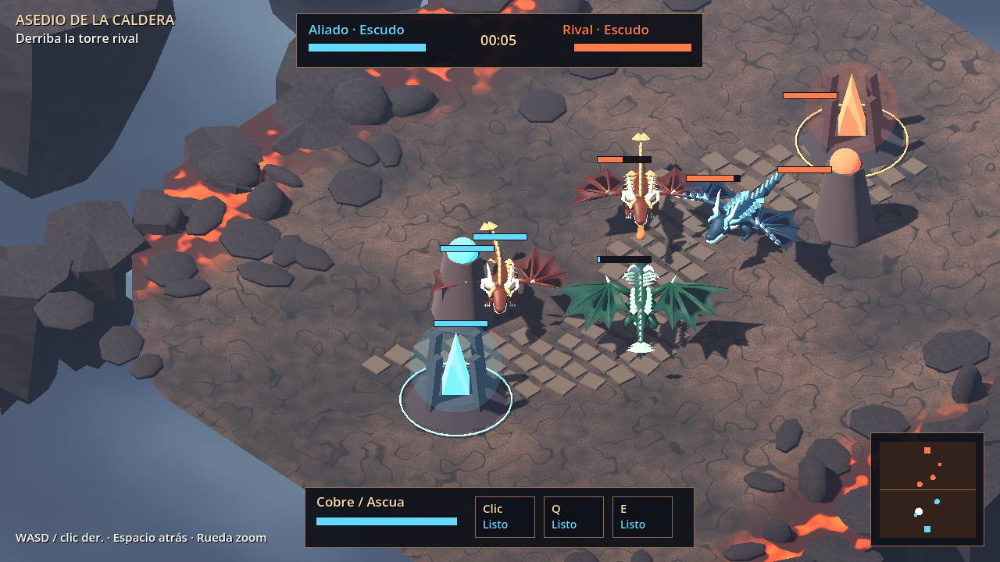
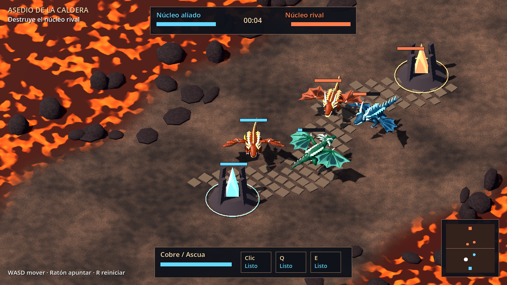

## V0.6 — Códice y modos del atlas

Extrae el ZIP, importa `game/project.godot` en Godot 4.6.3 y pulsa F5. El Códice de los jinetes ofrece búsqueda por sección. El Pacto, Cinco bastiones, Halvalas y Mire Bog se seleccionan directamente en el mapa. Las cantidades de oro, tiempos y balance son provisionales.

Consulta `docs/obsidian/Wiki y cobertura jugable.md` para ver las fuentes, las diferencias y el alcance por modo.

## V0.5 T02 — Atlas y duelo LAN

F5 abre el atlas ilustrado. Elige un destino para leer el objetivo y entrar. Dragones y equipo abre el selector. Guía de modos resume los seis destinos jugables y explica los modos pendientes ARAM, Aventura y Capture Points de cinco puntos.

Para jugar entre dos PC, abre el mismo proyecto en ambos con Godot 4.6.3. En una misma red, elige Multijugador LAN → Abrir sala LAN. El anfitrión pulsa Crear sala y comparte la IP mostrada. El invitado introduce esa dirección y pulsa Unirme. La sala usa UDP 27940. Si Windows pide permiso al juego para la red local, permite redes privadas. WASD mueve al dragón, el cursor apunta y el clic izquierdo dispara. Cada dragón comienza con 100 PV. El primer derribo termina el duelo. Salir al atlas permite comenzar una sala nueva.

Las Agujas es un duelo entre Cobre y Jade con estadísticas iguales. El anfitrión resuelve movimiento, daño y resultado. Los mapas 5v5 mantienen sus nueve bots. Ilustración original generada para el atlas en esta entrega.

Extrae el ZIP e importa `game/project.godot`.

## V0.5 T01 — Nethergate 5 contra 5

En el selector, elige Nethergate para volar entre islas sobre un barranco. En cada una de las tres runas, el equipo con más dragones vivos presentes avanza la captura. Las runas aceleran la carga del titán de su equipo. El titán marcha contra la puerta y su primer impacto desactiva el escudo. Escolta al aliado o intercepta al enemigo. Al romper la puerta aparece el resultado y emerge el titán liberado.

Inspiración visual y reglas generales: pantalla de carga y capturas de Nethergate aportadas por el jugador. Geometría, materiales, número y ubicación de las runas, tiempos, resistencia y daño son decisiones del prototipo. Juego local con nueve bots.

Extrae el ZIP, importa `game/project.godot` en Godot 4.6.3, pulsa F5 y selecciona Nethergate. M abre la vista táctica.

## V0.4 T04 — Ángeles, demonios y anuncio de victoria

En Frontera de Ceniza, la primera oleada aparece a los cinco segundos. Los tres carriles aliados reciben ángeles con plumas, aureola y lanza. Los tres rivales reciben demonios con cuernos, cola y alas membranosas. Los modelos originales se generan en Blender con `tools/art/build_minions.py` y sus alas se animan durante el combate.

El estallido del núcleo rival muestra VICTORIA en el mismo instante. La ruptura del núcleo aliado muestra DERROTA. El cartel deja despejado el cristal y da paso al resumen con las bajas y la opción de reiniciar.

Extrae el ZIP, importa `game/project.godot` en Godot 4.6.3, pulsa F5 y elige Frontera de Ceniza.

## V0.4 T03 — Cobre y ruptura del núcleo

Cobre lleva un jinete con yelmo, silla oscura, dos cuernos de basalto, espolón nasal y brazales con engastes turquesa. La membrana ámbar tiene bandas oscuras. El disparo básico produce una llamarada breve en la boca. Conserva el esqueleto y los cuatro clips de la versión anterior. La lámina original y el render del GLB están en `docs/arte`.

En Frontera de Ceniza, la lista lateral muestra la salud de los cinco aliados. Al caer un núcleo se cierra el combate, la cámara viaja hasta el objetivo y el cristal se rompe. Tras 2,7 s aparecen el resultado, las bajas, la duración y la oleada. La derrota usa el núcleo aliado. R permite reiniciar incluso durante la secuencia.

Extrae el ZIP, importa `game/project.godot`, pulsa F5 y elige Cobre → Frontera de Ceniza. En Galería puedes girar el modelo.

## V0.4 T02 — Oleadas y Jade

En Frontera de Ceniza aparece la primera oleada a los cinco segundos. Cada
equipo envía una unidad por carril cada doce segundos, con un máximo de dos
vivas por equipo y carril. Los bots se retiran a su base al 25 % de salud
o menos y vuelven al alcanzar el 75 %.

Jade tiene el cuerpo más estrecho, alas más largas, puntas turquesa
luminosas y cola extendida. Selecciona a Jade y entra en Frontera de Ceniza
o abre la galería para ver el modelo.



## V0.4 T01 — Frontera de Ceniza 5v5

Importa `game/project.godot` con Godot 4.6.3 y presiona F5. Elige **Frontera
de Ceniza · 5 contra 5**. Tu equipo lo forman tú y cuatro bots, frente a
cinco bots rivales. Derriba las tres torres rivales y destruye su núcleo.
Los dragones reaparecen en su lado tras seis segundos.

La cámara cenital oblicua sigue al jugador. La rueda cambia el zoom y **M**
abre o cierra el mapa táctico en vivo. El minimapa muestra los tres carriles,
dragones, torres y núcleos. Las rocas y la nieve son decorativas.




## V0.3 T05 — Materiales e impactos

Cobre, Jade y Sentinela tienen mapas de normales en piel y alas y una
mandíbula y mirada refinadas. La Caldera usa rocas con relieve. En el asedio,
los impactos de proyectiles muestran un destello, una onda y chispas.



Importa `game/project.godot` en Godot 4.6.3 y pulsa F5.
La bóveda de continuidad está en `docs/obsidian`.

## V0.3 T04 — Arte de los dragones y la Caldera

En **Ver dragones 3D**, revisa los nuevos perfiles de Cobre, Jade y Sentinela.
Los mismos modelos se usan en partida. **Asedio de la Caldera** agrega
acantilados irregulares, islas exteriores, bruma animada y basalto agrietado.
Abre `game/project.godot` en Godot 4.6.3 y presiona F5.



## V0.3 T03 — Torres y vuelo al cursor

En Asedio de la Caldera, derriba la torre rival antes de atacar el núcleo.
Usa WASD o mantén clic derecho/Shift para volar al cursor; Espacio retrocede
y la rueda ajusta el zoom. R reinicia la partida.

Abre `docs/obsidian` como bóveda en Obsidian y lee `Inicio.md`.

## V0.3 T02 — Asedio de la Caldera

Importa `game/project.godot` en Godot 4.6.3 y presiona F5. Elige dragón y arma y
pulsa **Asedio de la Caldera · 2 contra 2**. Tu compañero IA te ayuda a defender
el núcleo azul y a destruir el rival. El combate termina si cae tu dragón o
el núcleo aliado. Usa WASD, ratón, clic, Q y E. R reinicia la arena.

El HUD muestra salud, cargas, tiempo y posiciones de los equipos. Los modos
de duelo, captura de balizas y galería siguen accesibles desde el selector.



## V0.3 T01 — Captura de balizas

En Godot 4.6.3, abre `game/project.godot` y ejecuta con F5. Elige dragón y
arma y pulsa **Capturar balizas**. Mantente dos segundos en cada zona y
derrota al Sentinela en el orden que prefieras. El HUD muestra cuántas
zonas están capturadas. **Jugar con Cobre/Jade** abre el duelo clásico.

Prueba del objetivo: `godot --headless --path game --script res://tests/test_beacon_arena.gd`.

## V0.2 T05 — Dragones modelados, texturizados y animados

Cobre, Jade y Sentinela sustituyen las primitivas anteriores por modelos GLB
originales con malla orgánica, escamas, placas, membranas, ojos y garras.
Esqueleto de 16 huesos y clips de vuelo, ataque, impacto y muerte.

[Descargar Windows T05](https://chatgpt.com/library?file_id=libfile_61c5ea6eb3f08191982e6ddf4d93e61f&account_id=personal) — extraer todo y abrir `DragonsAndTitans.exe`.
En el selector, **Ver dragones 3D** abre la galería: elegir modelo y animación,
arrastrar para girar y rueda para acercar; Volver/Esc conserva dragón y arma.
El combate usa esos mismos modelos y mantiene su balance.

806 comprobaciones lógicas, 1879 gráficas y 269 sobre el PCK, sin fallos.
Windows nativo, valoración artística humana y rendimiento de laptop pendientes.
Dirección estilizada; no se afirma calidad cinematográfica o fidelidad al original.
Fuente editable y reproducción del arte: `docs/arte/DRAGONES_3D.md`.

## V0.2 T04 — Alas y arena

Cobre incorpora membranas curvas de doble cara con nervaduras sincronizadas y
placas cervicales. La arena tiene losas, roseta central, borde de orientación,
ruinas y rocas exteriores sin colisiones. Combate y balance conservados.

[Descargar candidato Windows T04](https://chatgpt.com/library?file_id=libfile_9b4a6cb377708191a86326a22825eb68&account_id=personal): extraer todo y abrir
`DragonsAndTitans.exe`. Windows nativo y rendimiento en laptop pendientes.

## V0.2 T03 — Primer incremento visual de Cobre

Cobre incorpora hocico facetado, placas dorsales, escamas, cuernos, dientes,
garras y nervaduras propias; vuelo con aleteo, cola, mandíbula al atacar,
reacción al daño y pliegue al morir. Se conserva el balance de T02, las cuatro
combinaciones y el reinicio. Jade y el enemigo mantienen su geometría previa.
Es una primera mejora estilizada procedural, no arte final ni modelo esculpido.

[Descargar candidato Windows T03](https://chatgpt.com/library?file_id=libfile_dfab7f1a5ecc81918d65d854f1b25c94&account_id=personal) — extraer todo y abrir
`DragonsAndTitans.exe`. Ejecución nativa Windows pendiente.

Para verlo: Godot 4.6.3 Standard → importar `game/project.godot` → F5 → Cobre.
No requiere Blender ni dependencias adicionales. El código fuente del arte está
en `game/scripts/dragon_presentation.gd`; procedencia y límites en
`docs/arte/COBRE.md`. Windows nativo continúa pendiente.

# DRAGONS AND TITANS

Recreación independiente y progresiva. **V0.2 T02** incorpora Cobre/Jade y
Ascua/Martillo astral: cuatro combinaciones, balance en recursos separados y
selección previa. Conserva combate, Q/E, victoria/derrota y reinicio de V0.1.
Validado en Linux con revisión gráfica; candidato Windows exportado y descargable
al final de esta página. **Windows nativo y prueba humana V0.2 pendientes**.
La valoración «decente» del usuario corresponde al prototipo anterior.

## Selección de dragón — V0.2 T01

Al iniciar se muestran dos tarjetas con sus atributos. Elegir mediante clic o
Tab/flechas y Enter/Espacio; pulsar **Jugar con Cobre/Jade**. La elección se
conserva durante la sesión. R y **Reiniciar** vuelven a la arena con ese dragón,
salud completa y recargas iniciales. Tras victoria o derrota, **Elegir dragón**
regresa al selector; no se cambia de perfil durante el combate. No hay guardado
en disco ni selección de armas en este primer incremento.

| Dato provisional | Cobre | Jade |
| --- | ---: | ---: |
| Salud | 100 | 70 |
| Velocidad, unidades/s | 6 | 8 |
| Básico: daño / recarga | 20 / 0.4 s | 15 / 0.3 s |
| Q: daño / recarga | 45 / 2.5 s | 35 / 2 s |
| E: daño / radio XZ / recarga | 30 / 4 / 4 s | 20 / 3.5 / 3 s |

Cobre conserva el balance anterior. Jade es más rápido y frágil, con menos daño
por impacto y recargas menores. Son decisiones propias **provisionales**, sin
afirmar fidelidad ni balance final. Comparten geometría propia, colisión y cámara;
Jade usa una paleta verde local, sin recolorear al enemigo cian ni a otros actores.

El balance autoritativo del jugador reside en
`game/data/dragons/cobre.tres` y `jade.tres`, tipados por `dragon_profile.gd`:
salud, velocidad, daños, recargas, proyectiles, radio/efecto de E y colores.
El controlador aplica esos datos sin fórmulas por nombre; las recargas y salud
actual viven en cada actor. `DragonRoster` conserva solo la elección de sesión.

## Candidato Windows V0.1 conservado para la laptop

Archivo: `DragonsAndTitans-v0.1-rc1-windows-x86_64-e40276a.zip` (35 977 332 bytes).
Se entrega como archivo descargable del chat y se conserva en `builds/t06/` del
entorno. La publicación de una release preliminar en GitHub está **bloqueada**:
la consulta API previa a crearla devuelve `Forbidden`. No hay URL de release
verificada; descargar el código de esta rama no descarga el ejecutable.
La comprobación de continuidad del 17 de noviembre de 2026 sigue recibiendo
`Forbidden`; se conserva el mismo ZIP y no se repite la exportación.

Extraer **todo** el ZIP y abrir `DragonsAndTitans.exe`, manteniendo el PCK en la
misma carpeta. No requiere instalar Godot ni iniciar sesión. Leer `LEEME.txt`,
también disponible en [docs/entrega/LEEME-WINDOWS.txt](docs/entrega/LEEME-WINDOWS.txt).
WASD mueve, el ratón orienta, clic dispara, Q/E activan habilidades y R o el botón
final reinician. El paquete es candidato para prueba; no tiene rendimiento ni
requisitos mínimos medidos. Hay una valoración general del usuario en laptop,
pero **los casos individuales y datos Windows/GPU no están reportados**.
Para registrar la prueba real, completar
[T06-prueba-windows.md](docs/validacion/T06-prueba-windows.md); sus filas siguen
pendientes. La guía incluida en el ZIP sigue vigente. Este ZIP conserva V0.1:
no contiene el selector V0.2 ni se le atribuyen las pruebas nuevas.

Código exportado: `e40276a5cb769e53794cd1f64832796772ec060f`.
SHA256 del ZIP: `aded62eaf281846fba54e2cd5437d3df8911b4cf1b34589b409e6f33a3adacda`.
El ZIP incluye VERSION.json, licencias y hashes de sus archivos. El sidecar
`.zip.sha256` permite comprobar la descarga con `Get-FileHash -Algorithm SHA256`.

## Requisitos

- **Godot 4.6.3 estable**, edición estándar con GDScript (no hace falta .NET).
  Versión usada: `4.6.3.stable.official.7d41c59c4`.
- Renderizador **Compatibility** (`gl_compatibility`), configurado en el proyecto.
- Plataforma objetivo: PC Windows. Exportación release Windows verificada desde
  Linux; ejecución nativa en Windows pendiente. La lógica y los gráficos se
  comprobaron en Linux. Los requisitos anteriores son para abrir el proyecto;
  el ZIP candidato contiene su motor y no requiere instalar Godot.

Descargar la edición correspondiente al sistema desde la
[publicación oficial de Godot 4.6.3](https://github.com/godotengine/godot/releases/tag/4.6.3-stable).
Extraer el ZIP en una carpeta local. No requiere paquetes, plugins ni credenciales.

## Abrir y ejecutar

En el gestor de proyectos de Godot, elegir **Importar**, seleccionar
`game/project.godot` y abrirlo. Pulsar **F6** para ejecutar la escena abierta o
**F5** para la escena principal. Aparece el selector Cobre/Jade; pulsar Jugar
abre la arena azul grisácea, el dragón elegido, el enemigo cian y el HUD.

Desde la raíz del repositorio, con `godot` en el `PATH` (Linux):

```bash
godot --version
godot --editor --path game
godot --path game
```

En PowerShell (Windows), ajustar la ruta a la carpeta extraída:

```powershell
# Ejecutar desde la raíz del repositorio.
$Godot = 'C:\Herramientas\Godot_v4.6.3-stable_win64.exe'
& $Godot --version
& $Godot --editor --path .\game
& $Godot --path .\game
```

Cerrar la ventana para terminar. Los comandos del editor en Windows aún no se
han ejecutado en ese sistema; el candidato descargable se exportó desde Linux.

## Controles provisionales

| Entrada | Función implementada |
| --- | --- |
| W / S | Mover hacia arriba / abajo en pantalla |
| A / D | Mover hacia izquierda / derecha en pantalla |
| Ratón | Orientar el hocico hacia el cursor sobre el plano de vuelo |
| Clic izquierdo mantenido | Disparar un proyectil por intervalo de recarga |
| Q (pulsar y soltar) | Proyectil potente hacia el hocico, con recarga propia |
| E (pulsar y soltar) | Pulso instantáneo centrado en el jugador |
| R | Reiniciar durante el juego o después del final |
| Botón Reiniciar | Clic, Enter o Espacio con el foco del panel final |
| Selector: clic / Tab / flechas / Enter / Espacio | Elegir tarjeta y activar Jugar |
| Botón Elegir dragón | Volver al selector después de terminar |

WASD usa teclas físicas mediante `move_forward`, `move_back`, `move_left` y
`move_right` en Input Map. El movimiento usa los ejes horizontales de la cámara,
independientemente de dónde apunte el dragón. La diagonal no aumenta la velocidad.
La altura es fija: no hay ascenso ni descenso. El cursor muy próximo al centro
del dragón conserva la orientación anterior para evitar giros indeterminados.

La raíz del dragón solo se traslada en física; el hijo `Facing` gira. La cámara
hereda la traslación sin girar y usa interpolación física. El controlador exporta
altura (1.5), semitamaño de arena (12×12) y margen (2). La velocidad procede del
perfil (Cobre 6/Jade 8 unidades/s).
El centro queda limitado a X/Z entre −10 y 10, suficiente para la silueta actual
de radio máximo 1.95. La cámara conserva el ángulo de T01 y ajusta su tamaño
ortográfico a 18 para hacer legible el personaje. Todos estos valores son
**provisionales**. Q/E usan teclas físicas, sin repetición por eco ni al mantenerlas:
después de la recarga hay que soltar y volver a pulsar. Un intento rechazado
durante recarga no se ejecuta más tarde automáticamente.

## Combate provisional de T03

El dragón elegido y el enemigo cian pertenecen a facciones rivales. El enemigo
persigue y ataca dentro de alcance; se detiene si él o el jugador mueren. Los
actores muertos no se mueven ni generan nuevos ataques. El panel muestra salud,
recargas y objetivo. Al terminar, ambos actores quedan bloqueados, incluido el ganador vivo.

Los datos de la tabla siguiente corresponden al perfil Cobre y al enemigo de V0.1;
Jade usa los valores de la comparación anterior.

| Parámetro exportado | Cobre | Enemigo |
| --- | --- | --- |
| Salud máxima | 100 | 80 |
| Daño básico | 20 | 10 |
| Recarga | 0.4 s | 1 s |
| Velocidad de proyectil | 28 unidades/s | 28 unidades/s |
| Duración del proyectil | 2 s | 2 s |
| Velocidad de movimiento | 6 unidades/s | 3 unidades/s |
| Alcance de ataque de IA | — | 7 unidades |

Son valores **provisionales**, no estadísticas originales. El balance del jugador
se ajusta en su recurso `.tres`; los nodos reciben esos datos al iniciar. Los del
enemigo siguen exportados en su escena/controlador. No hay cifras de balance en UI.
La colisión usa una esfera central de radio 0.8 por actor; alas y cola son
cosméticas. Los actores se limitan a la arena por posición, sin bloquearse entre sí.
El proyectil hace un raycast continuo de todo su trayecto físico, incluido el
tramo inicial entre el actor y el hocico, para evitar saltarse objetivos cercanos
o atravesarlos por velocidad. Ignora emisor, aliados y muertos; aplica daño una
sola vez al primer hostil válido y se elimina. También caduca si no impacta.
Los daños del mismo paso físico pueden resolverse antes del resultado; al cerrar
la partida se neutralizan y retiran los proyectiles restantes.

**R** y el botón **Reiniciar** recargan `res://scenes/arena.tscn`: restablecen
salud, posiciones, orientación, recargas, objetivo de IA, estados e indicadores;
eliminan actores, proyectiles, efectos y conexiones de la escena anterior.

## Habilidades provisionales de T04

Esta tabla corresponde a Cobre; Jade usa el balance de su recurso y de la
comparación del selector.

| Parámetro exportado | Q: proyectil potente | E: pulso |
| --- | --- | --- |
| Daño | 45 | 30 por hostil válido |
| Recarga propia | 2.5 s | 4 s |
| Velocidad | 36 unidades/s | Instantáneo |
| Duración | Proyectil: 2 s | Efecto visual: 0.5 s |
| Alcance de área | — | Radio XZ: 4 unidades |

Q aparece como esfera magenta de radio visual 0.3, frente a la esfera amarilla
de radio 0.15 del básico. Reutiliza íntegra la colisión continua de T03, incluidas
facciones, impacto único y el tramo inicial entre actor y hocico.
Se ejecuta en `Dragon/PowerWeapon`; el básico permanece en `Dragon/Weapon`.
Sus daños, tiempos y parámetros de proyectil proceden del perfil `.tres`.

E se ejecuta en `Dragon/PulseAbility`, con daño/radio/tiempos del perfil `.tres`.
Afecta una vez a cada hostil vivo cuya
distancia entre **centros XZ** cumpla **d² ≤ radio²**: la frontera está incluida,
la altura Y se ignora y tocar el área con el collider no basta si el centro está
fuera. Ignora emisor, aliados, muertos y objetivos inválidos. El anillo cian verde
marca el radio y es solo visual: su permanencia no repite daño. Se elimina al
terminar su duración. E en vacío es una activación válida y consume recarga.

Básico, Q y E tienen recargas independientes. Rechazos por recarga, muerte o
configuración inválida no crean efectos ni consumen recarga. El HUD muestra
`Q: LISTA`/`E: LISTA`, segundos restantes o `BLOQUEADA` al terminar la partida.
**R** también elimina efectos de E/proyectiles de Q y restaura sus recargas.
Todos los valores, materiales y geometrías son provisionales y propios.
Las habilidades forman parte del ciclo T05 y del candidato T06 exportado. V0.2
las conserva con balance por perfil. Los casos detallados de Windows/laptop y
la ejecución nativa de este incremento nuevo siguen pendientes.

## Ciclo de partida T05

- **Jugando:** vencer al enemigo es el objetivo provisional. Movimiento, básico y Q/E disponibles según sus recargas.
- **Victoria:** el enemigo ha muerto y el jugador sigue vivo.
- **Derrota:** el jugador ha muerto. Si ambos mueren en el mismo paso de resolución, se prioriza derrota.

La resolución ocurre al final de cada paso físico, después de actores y
proyectiles. Esa prioridad de empate es una regla **provisional**, no del original.
Una partida terminada no vuelve a resolverse ni emite dos finales. Se bloquean
movimiento, básico/Q/E y daño de ambos actores; se limpian proyectiles y efectos.
La interfaz sigue activa, sin pausa global. El panel final muestra **VICTORIA** o
**DERROTA**, con el botón **Reiniciar** enfocado para Enter/Espacio y accesible por clic.

Se conserva R durante el juego. Tras cualquier reinicio, soltar las teclas y el
clic que estaban mantenidos antes de volver: el HUD lo indica. Esas entradas no
mueven ni disparan automáticamente en la nueva escena. Los clics/Enter de reinicio
y las solicitudes rápidas no deben producir acciones ni escenas duplicadas.

El HUD se comprueba en ventana de **1280×720** y **960×540**, con escalado de Godot:
objetivo/controles/vida/recargas arriba, resultado y botón abajo, jugador visible
al centro. Son recursos provisionales propios. Esto completa el ciclo offline,
pero la aceptación integral T06 sigue pendiente: el paquete Windows es un
candidato exportado con valoración general en laptop, sin casos Windows reportados.

## Comprobaciones reproducibles

Desde la raíz, con Godot 4.6.3:

```bash
godot --headless --path game --import
godot --headless --path game --script res://tests/test_t02.gd
godot --headless --path game --script res://tests/test_combat_core.gd
godot --headless --path game --script res://tests/test_t03.gd
godot --headless --path game --script res://tests/test_power_projectile.gd
godot --headless --path game --script res://tests/test_pulse.gd
godot --headless --path game --script res://tests/test_t04.gd
godot --headless --path game --script res://tests/test_match_state.gd
godot --headless --path game --script res://tests/test_dragon_profiles.gd
godot --headless --path game --script res://tests/test_dragon_selection.gd
godot --headless --path game --script res://tests/test_v02_match.gd
godot --headless --path game --quit-after 120
```

En PowerShell, usar `& $Godot` en lugar de `godot` y `--path .\game`.
Los comandos deben terminar con código 0 y sin errores. La regresión T02 conserva
34 comprobaciones de movimiento, límites, apuntado y cámara. El núcleo añade 51
comprobaciones de salud, facciones, recargas y barridos físicos reales (incluido
un proyectil a 600 unidades/s); la integración T03 añade 52 comprobaciones de
entrada, IA, muerte y tres restauraciones de la escena completa.
T04 añade 57 comprobaciones de Q, 78 del pulso y 42 de integración de entrada,
independencia, eco/tecla mantenida, muerte y restauración de habilidades.
T05 añade 51 comprobaciones de estados, empate, bloqueo completo, reinicio rápido
y controles retenidos. Los montajes T03/T04 pausan solo la resolución de partida
para conservar pruebas de componentes después de muerte; no se retiran aserciones.
La suite de T05 usa la resolución real y comprueba el cierre global.
V0.2 añade perfiles 93/0, selector 64/0 y partida 46/0: datos aplicados, daño real,
aislamiento de salud/recargas/materiales, selección inválida, navegación inmediata,
conservación del perfil al reiniciar y vuelta al selector. Las suites heredadas
siguen usando Cobre como perfil inicial y conservan todas sus aserciones.
En headless no hay cursor OS: las pruebas de apuntado dan coordenadas explícitas
al mismo método que usa el controlador. El último comando carga la escena
principal durante 120 iteraciones; **headless no valida la imagen ni el manejo**.
Comprobar también visualmente con `godot --path game` (o F5).

Con un servidor gráfico disponible en Linux se puede ejecutar la prueba de ventana:

```bash
godot --path game --audio-driver Dummy --script res://tests/test_t02_window.gd -- --output-dir=/tmp/dragons-t02
```

Usa el Input Map con eventos de teclas físicas, el paso de física real y el cursor
de la ventana; recorre las cuatro esquinas, comprueba seguimiento/apuntado y guarda
dos capturas. Debe terminar con 22 comprobaciones y 0 fallos. Es automatizada;
no sustituye una sesión humana de manejo prolongada ni la validación Windows.

Combate gráfico T03, con el mismo servidor gráfico disponible:

```bash
godot --path game --audio-driver Dummy --script res://tests/test_t03_window.gd -- --output-dir=/tmp/dragons-t03/graphics
```

Esta prueba usa eventos de clic y R, el cursor de la ventana y física real:
dispara, recibe daño, abate al enemigo, restaura tres veces y deja que la IA
derrote al jugador. Guarda capturas de combate, enemigo abatido y jugador caído.
La regresión T02 pausa únicamente la IA en su montaje para aislar movimiento y
cámara; conserva todas sus aserciones. La prueba de T03 cubre la IA activa.

Prueba gráfica de habilidades T04:

```bash
godot --path game --audio-driver Dummy --script res://tests/test_t04_window.gd -- --output-dir=/tmp/dragons-t04/graphics
```

Usa Q/E/R físicos, cursor de ventana y colisión real. Guarda capturas del
proyectil magenta y el pulso con indicadores; comprueba eco, recarga y tres
restauraciones con habilidades activas. La IA se pausa en este montaje para
aislar Q/E; la regresión T03 comprueba combate con IA activa. Las posiciones de
prueba y los tiempos de espera abreviados del montaje no cambian el balance del juego.
Es una prueba automatizada con inspección de capturas, no manejo humano ni Windows.

Prueba gráfica completa T05:

```bash
godot --path game --audio-driver Dummy --script res://tests/test_t05_window.gd -- --output-dir=/tmp/dragons-t05/graphics
```

Prueba ambas ventanas nativas, ganar/perder mediante combate, bloqueo posterior,
foco, botón por ratón/Enter y R, tres reinicios alternos por resolución y entradas
retenidas: 145 comprobaciones y 0 fallos en Linux. Guarda seis capturas nativas
(jugando/victoria/derrota en cada tamaño).
Requiere un backend con captura de pantalla; en Linux se validó X11. No sustituye
una prueba humana. Las regresiones gráficas T02/T03/T04 continúan siendo útiles.

La suite gráfica del selector y los dos perfiles se ejecuta con:

```bash
godot --path game --display-driver x11 --audio-driver Dummy --script res://tests/test_v02_window.gd -- --output-dir=/tmp/dragons-v02/graphics
```

Resultado Linux: **777 comprobaciones, 0 fallos**. Recorre selección por ratón y
teclado, básico/Q/E reales, victoria/derrota, bloqueo, doce reinicios conservando
perfil y retorno para cambiar de dragón, en 1280×720 y 960×540. Guarda dieciséis
capturas nativas. La automatización y revisión de imágenes no acreditan una
prueba humana o Windows del nuevo incremento.

La caché `game/.godot/` se regenera y está excluida de Git. Si un contenedor Linux
no permite escribir en el directorio de usuario, preparar directorios escribibles
antes de ejecutar los comandos anteriores:

```bash
mkdir -p /tmp/dragons-t01/cache /tmp/dragons-t01/data /tmp/dragons-t01/config
export XDG_CACHE_HOME=/tmp/dragons-t01/cache
export XDG_DATA_HOME=/tmp/dragons-t01/data
export XDG_CONFIG_HOME=/tmp/dragons-t01/config
```

## Reproducir la exportación Windows T06

En Linux, con Python 3.12+, Godot exacto `4.6.3.stable.official.7d41c59c4`, curl y
unzip, descargar las plantillas oficiales estándar (no .NET). Guardarlas fuera de
Git y verificar su SHA512 publicado antes de extraer:

```bash
mkdir -p builds/godot-templates
curl -fL https://github.com/godotengine/godot-builds/releases/download/4.6.3-stable/Godot_v4.6.3-stable_export_templates.tpz -o builds/Godot_v4.6.3-stable_export_templates.tpz
printf '%s  %s\n' da606b61c10157844f8300172df374472665f95015495cb1a7cd132c40ede404faa96cc1016a4b9662db9909ddea69632c4948b2cd11163438dad4808881fb68 builds/Godot_v4.6.3-stable_export_templates.tpz | sha512sum --check
unzip -j builds/Godot_v4.6.3-stable_export_templates.tpz templates/windows_release_x86_64.exe templates/version.txt -d builds/godot-templates
python3 tools/package_windows.py --ref e40276a5cb769e53794cd1f64832796772ec060f --templates builds/godot-templates --output-dir builds/t06-reproduccion
```

El preset `game/export_presets.cfg` genera release x86_64 con EXE y PCK externos,
sin firma ni modificación de recursos Windows. Excluye `tests/*`. El script usa
`git archive` del SHA resuelto, importación y exportación en directorios temporales
con XDG propios: no incorpora cambios sin commit ni necesita la caché del checkout.
Incluye guía/licencias, VERSION.json con el SHA exacto y hashes de preset/plantilla,
y SHA256SUMS.txt; verifica PE x86_64, PCK, CRC, extracción limpia y hashes. Conserva
ZIP, sidecar, reporte JSON y log en el directorio elegido; no reemplaza un ZIP existente.
Reproducir el proceso puede producir otro hash ZIP por marcas temporales del motor
y del contenedor: comprobar el manifiesto y el nuevo sidecar, no prometer igualdad binaria.

La inspección independiente del candidato encontró 37 entradas PCK válidas,
sin tests ni cachés del editor. La carga de ese PCK con Godot Linux comprueba los
datos exportados y se distingue de ejecutar `DragonsAndTitans.exe` en Windows.
Los resultados, evidencia y pendientes están en [docs/ESTADO.md](docs/ESTADO.md).

## Estructura y recursos

- `game/project.godot`: configuración y escena de entrada.
- `game/scenes/arena.tscn`: suelo, entorno, luz, dragón y panel de controles.
- `game/scenes/dragon.tscn`: composición del controlador, representación y cámara.
- `game/scenes/dragon_visual.tscn`: geometría provisional propia, sin lógica.
- `game/scripts/dragon_controller.gd`: movimiento, límites y orientación.
- `game/data/dragons/*.tres` y `game/scripts/dragon_profile.gd`: balance separado.
- `game/scripts/dragon_roster.gd`: selección temporal en sesión.
- `game/scenes/dragon_selection.tscn` y su script: comparación y entrada a la arena.
- `game/scripts/combat_actor.gd`: salud, facciones y señales de daño/muerte.
- `game/scripts/weapon.gd` y `projectile.gd`: recarga, disparo y barrido físico.
- `game/scenes/power_projectile.tscn`: aspecto propio de Q, mismo proyectil lógico.
- `game/scripts/pulse_ability.gd`: daño instantáneo y recarga de E.
- `game/scripts/pulse_effect.gd` y `game/scenes/pulse_effect.tscn`: anillo temporal sin daño.
- `game/scripts/enemy_controller.gd` y `game/scenes/enemy.tscn`: IA y visual cian propio.
- `game/scripts/arena.gd`: estados, cierre, HUD y reinicio protegido.
- `game/scripts/hud.gd` y `game/scenes/hud.tscn`: estado/objetivo y panel final accesible.
- `game/tests/`: pruebas de integración headless y de ventana.
- `docs/IMPLEMENTACION.md`: tareas y aceptación de V0.1.
- `docs/ESTADO.md`: resultados, limitaciones y siguiente paso para cualquier IA.

La geometría y los materiales de la arena, los dos actores y el proyectil se crearon para este
repositorio con primitivas de Godot y polígonos CSG para las membranas de las alas;
no contienen arte del juego original ni recursos de terceros.
Las dimensiones, colores y cámara son decisiones **provisionales** del prototipo,
no datos verificados de Dragons and Titans. Los recursos adicionales se añadirán
cuando las siguientes tareas los necesiten.

## V0.2 T02 — Equipamiento (reimplementación)
En el selector elige Cobre/Jade y Ascua/Martillo astral, con ratón o Tab y Enter.
Ascua conserva el básico previo; Martillo aplica ×1.8 al daño (redondeo al entero
más cercano, mínimo 1) y ×2 a la recarga. Salud, movimiento y Q/E pertenecen al
dragón. Reiniciar conserva ambas elecciones en memoria; al terminar puedes volver
al selector. Nombres, cifras, geometría y materiales propios provisionales.
Validación lógica Linux registrada en docs/validacion/V02-T02-reimplementacion.log.
Validación gráfica Linux completada: 2812 comprobaciones aprobadas.
Windows nativo y prueba humana V0.2 pendientes.

[Descargar candidato Windows V0.2 T02](https://chatgpt.com/library?file_id=libfile_6075c6e6f5888191af9a8cba50e5ff3c&account_id=personal) (34,3 MiB).
Extrae todo y abre DragonsAndTitans.exe. Conserva el PCK junto al EXE.
Guía: docs/entrega/V02-T02-LEEME-WINDOWS.txt.
Trazabilidad y hashes: docs/validacion/V02-T02-paquete.json.

Para probar solo el movimiento en Godot 4.6.3, importa `game/project.godot`, pulsa F5 y elige **Práctica de vuelo** en el atlas. El árbol de nodos y los ajustes de cámara están en [Práctica de vuelo](docs/obsidian/Práctica%20de%20vuelo.md).
